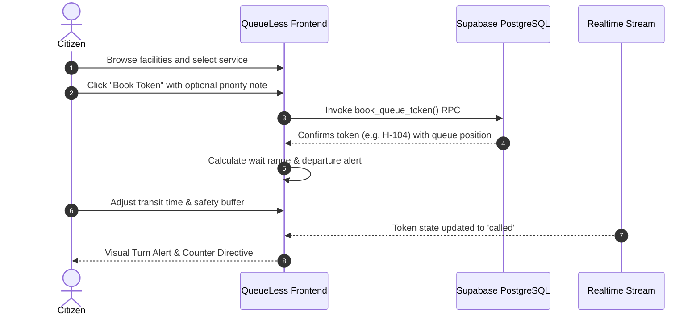
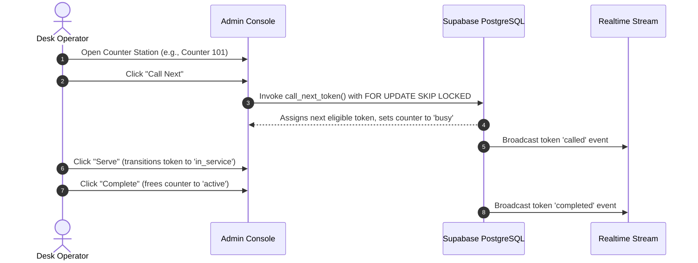

# QueueLess AI

<div align="center">


<br />
**Smart Universal Virtual Queue Management & Telemetry System**  
*Skip the physical line. Plan your journey. Own your time.*

[](https://react.dev/)
[](https://vitejs.dev/)
[](https://tailwindcss.com/)
[](https://supabase.com/)
[](#project-status)

**Team GEN4X** • **INTELLATHON 2K26**

[Key Features](#-key-features) • [System Architecture](#-system-architecture) • [User Roles & Workflow](#-user-roles-and-workflow) • [Local Setup](#-installation-and-local-setup) • [Supabase Configuration](#-supabase-configuration)

</div>

---

## 📖 Introduction

**QueueLess AI** is a universal virtual queue management and real-time telemetry platform designed to modernize public and private service waiting systems. Built for institutions experiencing heavy daily footfall—such as hospitals, government offices, commercial banks, university examination centers, and civic municipal centers—QueueLess AI allows citizens to join service queues remotely, receive transparent mathematical wait-time estimates, and plan their physical departure using customizable commute buffers.

For administrative staff, the platform provides a concurrency-safe counter dispatch dashboard powered by PostgreSQL atomic stored procedures (`FOR UPDATE SKIP LOCKED`), ensuring that desk operators can dispatch, serve, and complete tokens without race conditions or collision.

---

## ❗ Problem Statement

Physical waiting lines in high-density civic and administrative facilities suffer from chronic structural inefficiencies:

1. **Unproductive Time Loss:** Citizens spend hours sitting in congested waiting rooms with no visibility into true appointment timing.
2. **Waiting Room Overcrowding:** Overcrowded halls increase transmission of illnesses in healthcare centers and elevate stress levels in civic offices.
3. **Information Asymmetry:** Visitors cannot predict whether an OPD doctor or passport desk is running ahead of schedule or delayed by complex consultations.
4. **Administrative Bottlenecks & Collisions:** Manual token calling or uncoordinated multi-window setups frequently result in duplicate calls, skipped numbers, or desk idle time.
5. **Rigid Booking Windows:** Rigid slot-booking systems fail when individual service durations vary widely, causing fixed appointments to quickly fall out of sync.

---

## 💡 Our Solution

QueueLess AI replaces static appointment slots and chaotic physical lines with a dynamic, synchronized virtual queuing lifecycle:

```
[Remote Discovery] ➔ [Virtual Token Booking] ➔ [Dynamic Wait Telemetry] ➔ [Smart Departure Alert] ➔ [Just-In-Time Desk Arrival] ➔ [Service Completion]
```

- **Remote Booking:** Citizens book a virtual queue position from their smartphone or computer before traveling to the facility.
- **Transparent Queueing Heuristics:** The system computes wait times using transparent operations research principles (Little's Law heuristics adapted for multi-counter configurations) and displays an expected variance range.
- **Smart Departure Planning:** Citizens specify their transit duration and safety buffer; QueueLess AI calculates when to leave home (`stay_put`, `leave_soon`, or `leave_now`) so they arrive right as their token is called.
- **Concurrency-Safe Desk Dispatch:** Staff operate synchronized digital counters with atomic database locking, preventing multiple counters from claiming the same citizen.
- **Bilingual Accessibility:** Native support for both **English** and **Tamil (`தமிழ்`)** to serve diverse regional communities.

---

## ✨ Key Features

### 🎟️ Virtual Token Booking & Duplicate Prevention
- **Monotonic Daily Token Sequences:** Generates structured, facility-prefixed daily tokens (e.g., `H-101`, `G-102`, `B-103`).
- **Database-Level Duplicate Prevention:** A PostgreSQL partial unique constraint prevents a citizen from creating multiple concurrent active tokens for the same service.
- **Requirement Checklists:** Displays required documentation, estimated duration, and instructions prior to token confirmation.

### ⏱️ Transparent Queue Prediction Engine
- **Deterministic Operations Research Model:** Calculates estimated wait duration based on waiting queue depth, historical average service time, and active counter capacity:
  $$\text{Estimated Wait} = \frac{\text{People Ahead} \times \text{Average Service Minutes}}{\max(1, \text{Active Counters})}$$
- **Statistical Variance Ranges:** Rather than presenting misleading exact minute estimates, the platform calculates realistic confidence bounds ($-20\%$ for rapid flow to $+30\%$ for complex cases).
- **Congestion Classification:** Evaluates queue density into discrete visual tiers: *Brisk Flow*, *Moderate Traffic*, *Busy Queue*, and *Peak Congestion*.

### 🚗 Smart Departure & Travel Buffer Guidance
- **Just-In-Time Arrival Planning:** Computes recommended departure time dynamically:
  $$\text{Departure Time} = \text{Projected Turn Time} - (\text{Transit Time} + \text{Buffer Time})$$
- **Dynamic Urgency Alerts:**
  - 🟢 **Stay Put (`stay_put`):** Remaining time exceeds transit and buffer thresholds.
  - 🟡 **Leave Soon (`leave_soon`):** Departure window opens within 15 minutes.
  - 🔴 **Leave Now (`leave_now`):** Immediate departure required to maintain arrival buffer.
- **Token Cancellation:** Citizens can voluntarily cancel pending tokens with reason logging, instantly freeing queue capacity for others.

### 🖥️ Facility Administrator Dispatch Console
- **Atomic Counter Calling:** "Call Next" triggers an atomic database RPC utilizing `FOR UPDATE SKIP LOCKED` to prevent concurrency collisions across simultaneous desks.
- **Desk Workflow States:** Transitions tickets through discrete operational phases: `waiting` ➔ `called` ➔ `in_service` ➔ `completed`.
- **Operational Desk Controls:** Toggles counter availability between `active`, `break`, and `offline`, dynamically adjusting facility service throughput.
- **Live Queue Roster:** Comprehensive tabular overview of all queued visitors with timestamps, service types, and priority flags.

### 🔔 Synchronized Telemetry & Real-Time Alerts
- **WebSocket Synchronization:** Utilizes Supabase Realtime channels to instantly update citizen and administrator screens when tokens are called, advanced, or cancelled.
- **In-App Notification Feed:** Persisted alerts notifying users of status transitions and counter assignments.

### 🌐 Bilingual Interface
- Full localization supporting **English** and **Tamil (`தமிழ்`)** across all navigation menus, queue statuses, facility cards, and departure prompts.

### 🛡️ Enterprise Security & Privacy
- **Row Level Security (RLS):** 100% of database tables are protected by granular PostgreSQL policies isolating citizen records and administrative scopes.
- **Zero-PII Public Telemetry:** The public queue metrics function (`get_public_queue_metrics`) provides aggregated telemetry without exposing visitor names, phone numbers, or user IDs.

### ⚡ Resilient Dual-Mode Operation
- **Cloud-Ready:** Connects seamlessly to Supabase PostgreSQL, Auth, and Realtime via environment variables.
- **Local Fallback Mode:** When cloud credentials are not supplied, the platform automatically activates an in-memory reactive event store, allowing instant evaluation of all workflows without local database setup.

---

## 🛠️ Technology Stack

| Layer | Technologies | Purpose |
|---|---|---|
| **Frontend Framework** | React 19, Vite 8 | High-performance reactive UI and modern ES module builds |
| **Routing** | React Router DOM v7 | Client-side routing, protected routes, and layout hierarchies |
| **Styling & Design** | Tailwind CSS v3.4, PostCSS, Autoprefixer | Custom design system, glassmorphism, responsive grid |
| **Icons & Visuals** | Lucide React, Recharts | Consistent iconography and queue telemetry visualization |
| **Database & Auth** | Supabase (PostgreSQL 15+) | Relational data persistence, Row Level Security, user authentication |
| **Realtime Engine** | Supabase Realtime (WebSockets) | Instant state synchronization across citizen and admin views |
| **Linting & Quality** | Oxlint (`oxlint`) | Ultra-fast static analysis and hook validation |

---

## 🏗️ System Architecture

```mermaid
flowchart TD
    subgraph Clients["Presentation Layer (React 19 + Vite)"]
        A[Citizen View]
        B[Admin Console]
        C[Facilities Directory]
        D[Bilingual Context (EN / TA)]
    end

    subgraph ServiceLayer["Unified Data Service Layer (queueService.js)"]
        E{Supabase Configured?}
        F[Live Supabase Client]
        G[Local Reactive Event Store]
        H[Heuristic Prediction Engine]
    end

    subgraph Backend["Cloud Backend (Supabase PostgreSQL 15)"]
        I[Supabase Auth]
        J[Row Level Security Policies]
        K[Atomic Stored Procedures]
        L[(PostgreSQL Relational Tables)]
        M[Supabase Realtime WebSockets]
    end

    A --> E
    B --> E
    C --> E
    D -.-> A
    D -.-> B

    E -- Yes --> F
    E -- No (Fallback) --> G

    F --> I
    F --> J
    F --> K
    K --> L
    L --> M
    M -. Realtime Push .-> A
    M -. Realtime Push .-> B

    A --> H
    H --> A
```

### Database Schema Architecture

```
┌─────────────────┐       ┌─────────────────┐       ┌──────────────────┐
│   facilities    │1     *│    services     │1     *│     counters     │
├─────────────────┤───────├─────────────────┤───────├──────────────────┤
│ id (PK)         │       │ id (PK)         │       │ id (PK)          │
│ name            │       │ facility_id(FK) │       │ facility_id (FK) │
│ category        │       │ name            │       │ staff_name       │
│ location        │       │ avg_duration    │       │ status           │
└─────────────────┘       └─────────────────┘       └──────────────────┘
         │                         │                         │
         │1                        │1                        │1
         │                         │                         │
         │*                        │*                        │*
┌──────────────────────────────────────────────────────────────────────┐
│                            queue_tokens                              │
├──────────────────────────────────────────────────────────────────────┤
│ id (PK, UUID)                                                        │
│ facility_id (FK -> facilities.id)                                    │
│ service_id (FK -> services.id)                                       │
│ counter_id (FK -> counters.id, NULLABLE)                             │
│ user_id (FK -> auth.users.id)                                        │
│ token_number (e.g., 'H-104')                                         │
│ status ('waiting' | 'called' | 'in_service' | 'completed'|'cancelled')│
│ token_date (DATE)                                                    │
└──────────────────────────────────────────────────────────────────────┘
         │1                                                  │1
         │*                                                  │*
┌──────────────────┐                               ┌───────────────────┐
│   queue_events   │                               │   notifications   │
├──────────────────┤                               ├───────────────────┤
│ id (PK)          │                               │ id (PK)           │
│ token_id (FK)    │                               │ user_id (FK)      │
│ event_type       │                               │ token_id (FK)     │
│ details (JSONB)  │                               │ title / message   │
└──────────────────┘                               └───────────────────┘
```

---

## 👥 User Roles and Workflow

### 1. Citizen Workflow


### 2. Facility Administrator Workflow


### 3. Integrated Hackathon Persona Switcher
For seamless demonstration during evaluation, the navigation bar includes a 1-click **Persona Switcher**:
- **Citizen Persona:** Tests remote booking, live tracking, buffer adjustment, and cancellation.
- **Facility Admin Persona (Dr. Aris Mehta):** Tests desk management, operational counter toggling, and atomic ticket dispatching.
- **Super Administrator Persona:** Grants cross-facility oversight permissions.

---

## 🚀 Installation and Local Setup

### Prerequisites
- **Node.js:** `v18.0.0` or higher
- **npm:** `v9.0.0` or higher
- **Git**

### Step-by-Step Installation

1. **Clone the repository:**
   ```bash
   git clone https://github.com/koushikmonish2007-maker/QueueLess-AI.git
   cd QueueLess-AI
   ```

2. **Install project dependencies:**
   ```bash
   npm install
   ```

3. **Configure Environment Variables:**
   Copy the example environment file:
   ```bash
   cp .env.example .env
   ```
   *(If testing in demo mode without Supabase, the project runs out-of-the-box using its built-in reactive store).*

4. **Start the local development server:**
   ```bash
   npm run dev
   ```
   Open your browser and navigate to `http://localhost:5173`.

5. **Run static analysis & linting:**
   ```bash
   npm run lint
   ```

6. **Create a production build:**
   ```bash
   npm run build
   ```

---

## ⚡ Supabase Configuration

To connect QueueLess AI to your own live Supabase instance:

### Step 1: Create a Supabase Project
1. Log in to [Supabase](https://supabase.com) and create a new project.
2. Select your closest hosting region and set a secure database password.

### Step 2: Apply Database Migrations
1. In the Supabase Dashboard, open the **SQL Editor** from the left navigation panel.
2. Click **New Query**, open [`supabase/migrations/20261014000000_init_schema.sql`](./supabase/migrations/20261014000000_init_schema.sql), paste the entire script, and click **Run**.
3. Create another query, paste [`supabase/seed.sql`](./supabase/seed.sql), and click **Run** to seed initial demo facilities, departments, and counters.

### Step 3: Verify Realtime Replication
The migration script automatically runs:
```sql
ALTER PUBLICATION supabase_realtime ADD TABLE public.queue_tokens;
ALTER PUBLICATION supabase_realtime ADD TABLE public.counters;
ALTER PUBLICATION supabase_realtime ADD TABLE public.notifications;
```
Ensure under **Database** ➔ **Replication** that `queue_tokens` and `counters` are active.

### Step 4: Run Automated Verification Tests
Open the SQL Editor, paste the contents of [`supabase/tests/security_and_concurrency_test.sql`](./supabase/tests/security_and_concurrency_test.sql), and execute. The suite automatically verifies:
- Unauthenticated booking rejection
- Monotonic daily sequence numbering
- Desk lock handling during active consultations
- Non-recursive RLS policy isolation
- Zero-PII public metrics sanitization

### Step 5: Update Your `.env` File
Retrieve your Project URL and Public Anon Key from **Project Settings** ➔ **API**:
```env
VITE_SUPABASE_URL=https://your-project-id.supabase.co
VITE_SUPABASE_ANON_KEY=your-supabase-anon-key-here
```
> **Security Notice:** Never place the `service_role` key in client-side code or `.env`. Only the public `anon` key is required by the frontend.

---

## 📸 Application Preview

| View | Description |
|---|---|
| **Facility Discovery** | Explore civic facilities, OPD hospital wings, and bank branches with real-time congestion indicators and service listings. |
| **Citizen Telemetry Hub** | Live ticket monitoring displaying people ahead, confidence wait ranges, currently serving desks, and cancellation options. |
| **Smart Departure Planner** | Dynamic travel-buffer slider calculating exact departure time with `stay_put`, `leave_soon`, and `leave_now` urgency pills. |
| **Facility Admin Console** | Desk operator control panel equipped with atomic "Call Next", token status progression, and counter operational toggling. |
| **Bilingual Localization** | Full native Tamil (`தமிழ்`) and English translation toggle available across all views. |

---

## 🔮 Future Roadmap

- 📱 **SMS & WhatsApp Gateway Integration:** Direct SMS dispatch (via Twilio/Gupshup) to notify citizens without active internet connections or smartphones.
- 🖨️ **Hardware Turnstile & Kiosk Integration:** Physical entry validation through thermal kiosk ticket printers and QR-code turnstile scanners.
- 🧠 **Dynamic Machine Learning Service Duration:** Transitioning from deterministic queuing heuristics to trained ML regressors modeling weather, day-of-week, and staff-specific service velocities.
- 📊 **Municipal Cross-Facility Analytics:** High-level government oversight portal comparing average citizen wait times across multiple districts and hospital networks.
- 🔔 **Web Push Notifications:** Native browser background notifications when the application tab is minimized.

---

## 📊 Project Status

- **Current Version:** `0.0.0` (Phase 2 Prototype)
- **Development Phase:** **Phase 2 Complete** (Full backend schema, concurrency-safe RPCs, real-time WebSocket telemetry, bilingual UI, and local fallback).
- **Security Audit:** All tables guarded by RLS policies; zero public exposure of service-role keys or direct database credentials.
- **Repository Visibility:** Prepared for clean public distribution.

---

<div align="center">

**QueueLess AI — One Platform. Every Queue. Less Waiting.**  
*Engineered by **Team GEN4X** for **INTELLATHON 2K26**.*

</div>
